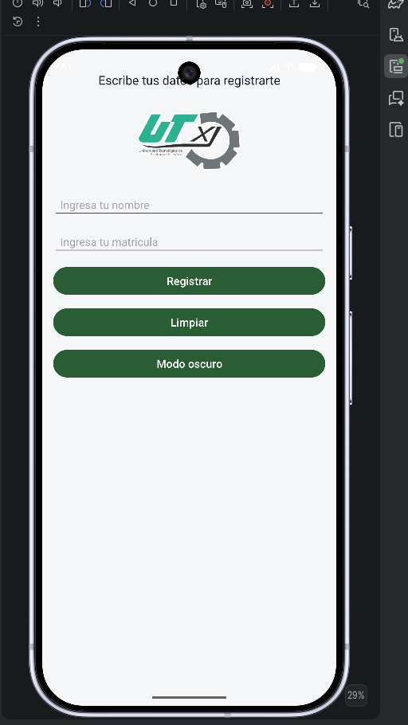
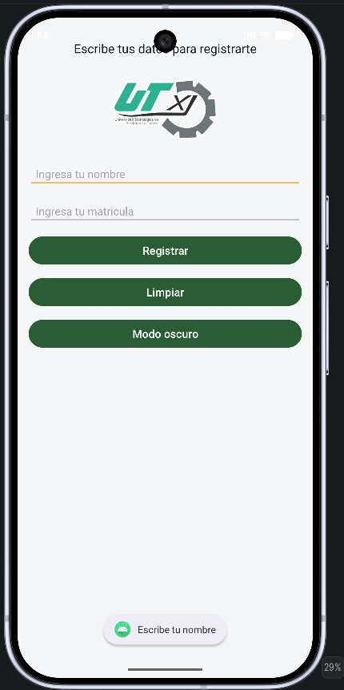
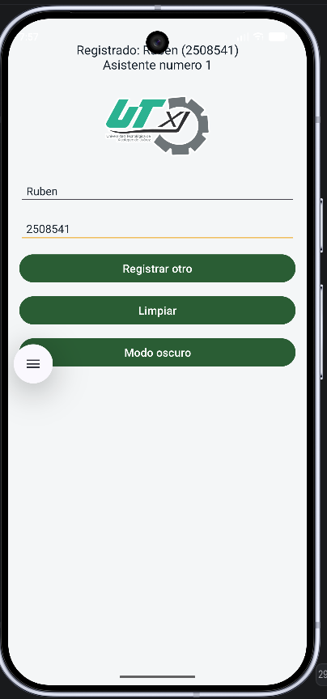
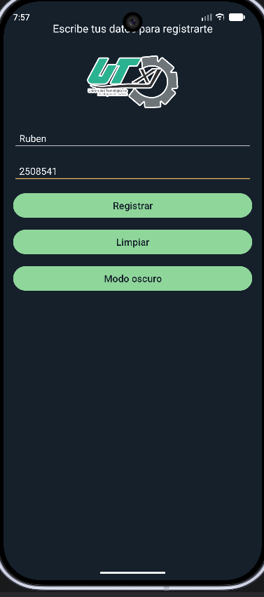
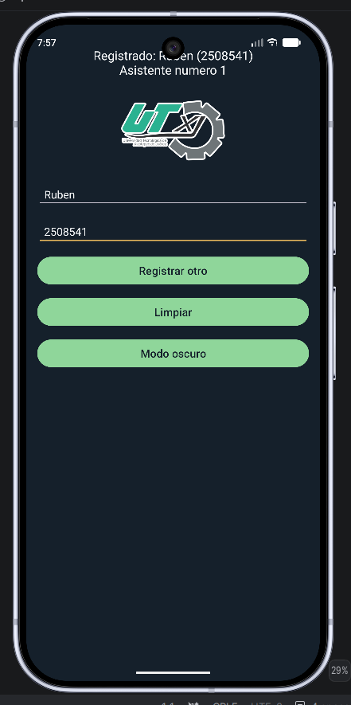
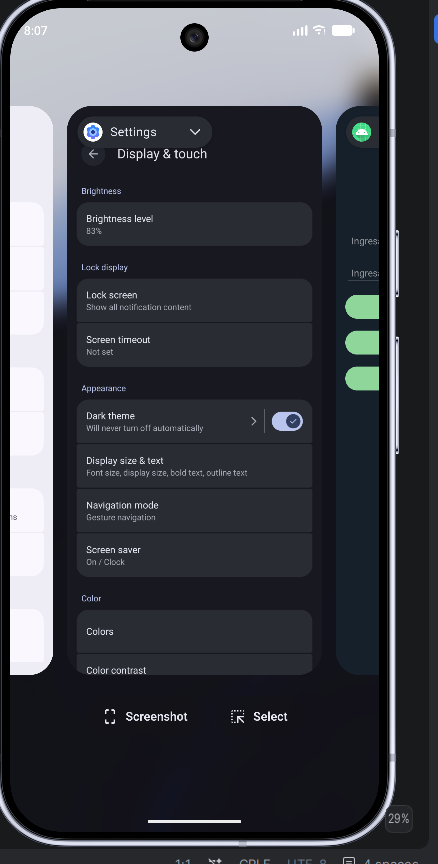
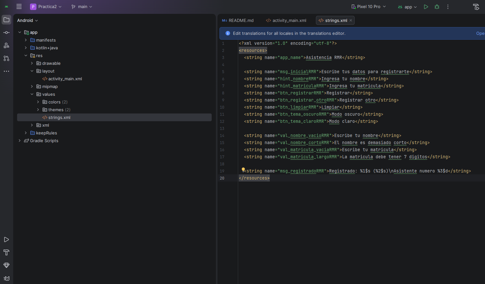
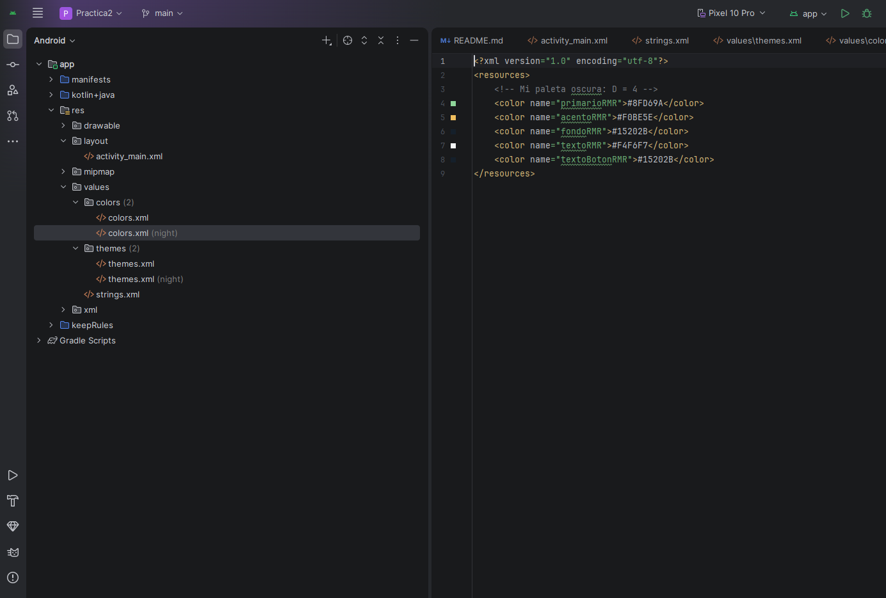
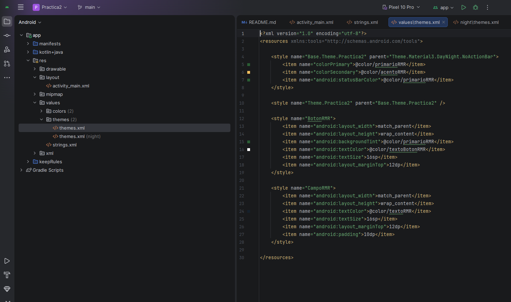

# Práctica 6 · Recursos, Estilos y Modo Oscuro
**Unidad II:** Diseño de aplicaciones móviles  
**Proyecto:** Registro de Asistencia  

---

## 👨‍💻 Datos del Alumno
- **Nombre:** Rubén Morales Reyes
- **Matrícula:** 250854
- **Iniciales (INI):** RMR
- **Último dígito ($D$):** 4
- **Paleta asignada ($D = 4$):**
  * **Primario (Claro):** `#2A5D34` (Verde)
  * **Acento:** `#F0BE5E` (Amarillo/Dorado)
  * **Primario (Oscuro):** `#8FD69A` (Verde Claro)
  * **Fondo (Claro):** `#F4F6F7` / **Fondo (Oscuro):** `#15202B`

---

## 🎯 Objetivo de la Práctica
Refactorizar la interfaz de usuario del proyecto de *Registro de Asistencia* para desacoplar textos, colores y estilos de las vistas XML y del código Kotlin. Toda la configuración visual y de datos vive en archivos de recursos (`strings.xml`, `colors.xml`, `themes.xml` y `values-night/colors.xml`), permitiendo el soporte nativo para **Modo Oscuro** (Dark Theme) tanto por preferencia del sistema como por un control manual en vivo.

---

## 🛠️ Cambios Implementados

1. **Extracción de Cadenas (`strings.xml`):**
   * Migración de los 13 textos de la interfaz (hints, botones, mensajes y avisos de validación) usando la nomenclatura con sufijo `RMR`[cite: 27].
   * Implementación de marcadores de posición (`%1$s`, `%2$s`, `%3$d`) para la interpolación dinámica del mensaje de confirmación del contador[cite: 1, 27].

2. **Gestión de Colores (`colors.xml` y `values-night/colors.xml`):**
   * Definición de la paleta personalizada según $D = 4$[cite: 1].
   * Creación de la carpeta de calificación `values-night` para la conmutación automática de colores en tema nocturno[cite: 1].

3. **Definición de Estilos (`themes.xml`):**
   * Creación de estilos reutilizables `BotonRMR` y `CampoRMR` para estandarizar márgenes, tamaños, colores de texto y fondos[cite: 1].

4. **Lógica en Kotlin (`MainActivity.kt`):**
   * Sustitución de cadenas hardcodeadas por `getString(R.string...)` en validaciones y en la función `limpiar()`[cite: 1].
   * Integración de `AppCompatDelegate.setDefaultNightMode()` para alternar manualmente el tema claro/oscuro desde el botón de la interfaz[cite: 1].

---

## 📱 Capturas del Funcionamiento (Paso 8)

| 1. Modo Claro Inicial | 2. Validación Nombre | 3. Registro Exitoso |
| :---: | :---: | :---: |
|  |  |  |
| *Apertura diurna ($D=4$)* | *Toast de campos vacíos* | *Contador formateado* |

 

| 4. Modo Oscuro Manual | 5. Regreso a Modo Claro | 6. Modo Oscuro Sistema |
| :---: | :---: | :---: |
|  |  |  |
| *Cambio desde botón app* | *Reversión de tema* | *Cambio desde ajustes* |

---

## 💻 Recursos XML Configurados

| Cadenas (`strings.xml`) | Colores Nocturnos (`colors.xml`) | Estilos (`themes.xml`) |
| :---: | :---: | :---: |
|  |  |  |

---

## 🧪 Pruebas Realizadas
- [x] Apertura de la aplicación en modo claro con paleta de color correspondiente[cite: 1].
- [x] Disparo de validaciones con Toast en orden (Nombre vacío, nombre corto, matrícula vacía, matrícula incompleta)[cite: 1].
- [x] Registro simulado de asistente con barra de progreso (1.5s) y actualización del contador[cite: 1].
- [x] Conmutación manual a Modo Oscuro mediante el botón de la app[cite: 1].
- [x] Retorno manual a Modo Claro actualizando el texto del botón dinámicamente[cite: 1].
- [x] Respuesta automática al cambio de tema global desde los ajustes del sistema operativo[cite: 1].

---

## 🖐️ Análisis de Ergonomía y Zonas del Pulgar

> En la interfaz desarrollada, los tres botones (`Registrar`, `Limpiar` y `Modo oscuro`) se ubican verticalmente en la zona inferior de la pantalla[cite: 1]. Al analizar su posición mediante las guías de usabilidad táctil, los botones de interacción frecuente (`Registrar` y `Limpiar`) quedan situados dentro de la **zona cómoda de alcance natural del pulgar** (*natural thumb zone*) al sujetar el teléfono con una sola mano[cite: 1]. El botón de `Modo oscuro` se encuentra al final del bloque, en una zona accesible pero de menor prioridad[cite: 1]. No cambiaría de lugar los botones primarios porque garantizan una interacción fluida en la captura de datos, pero sí consideraría mover la función de `Modo oscuro` a la barra superior de acciones (*ActionBar*) como un conmutador de icono, evitando saturar la columna de controles del formulario[cite: 1].
